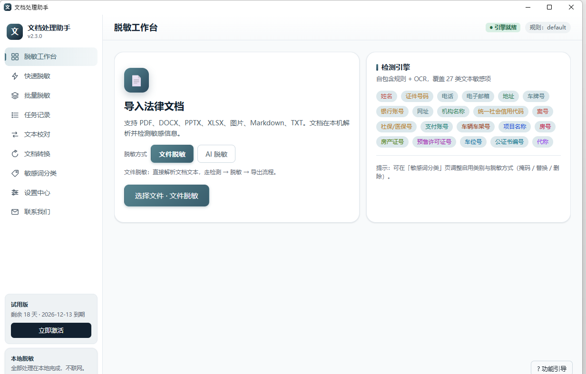
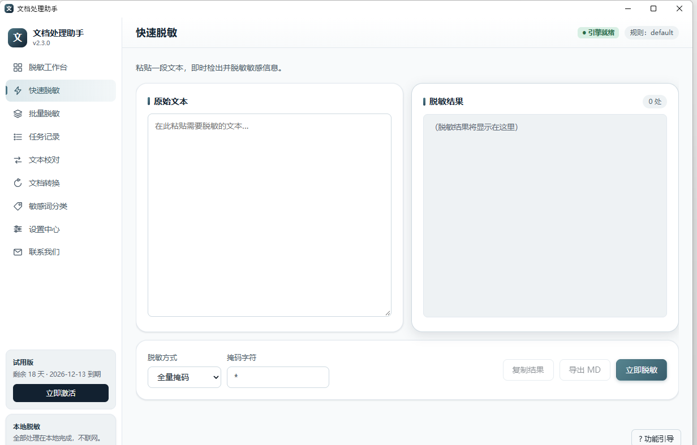
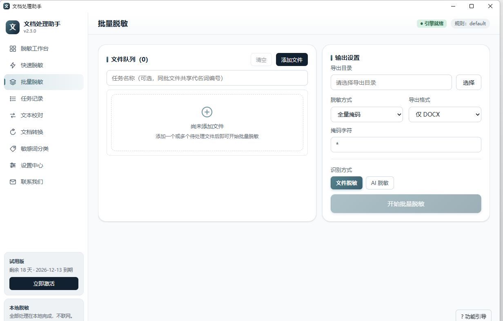
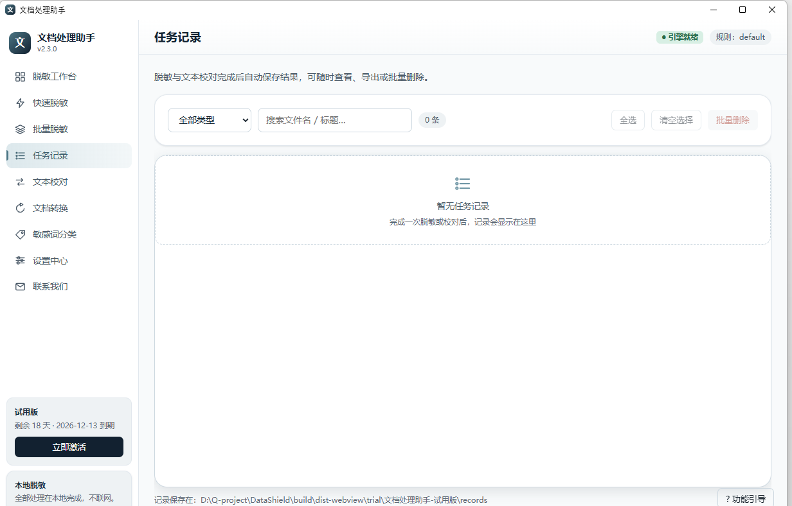
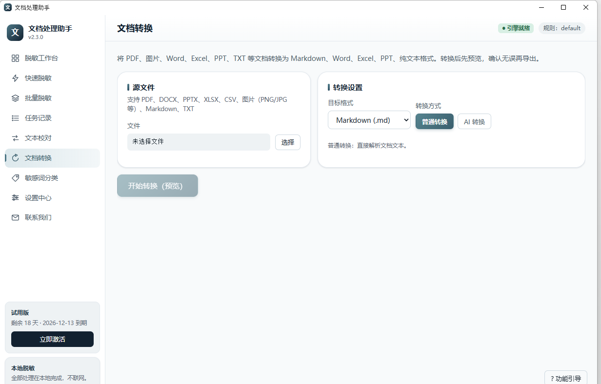
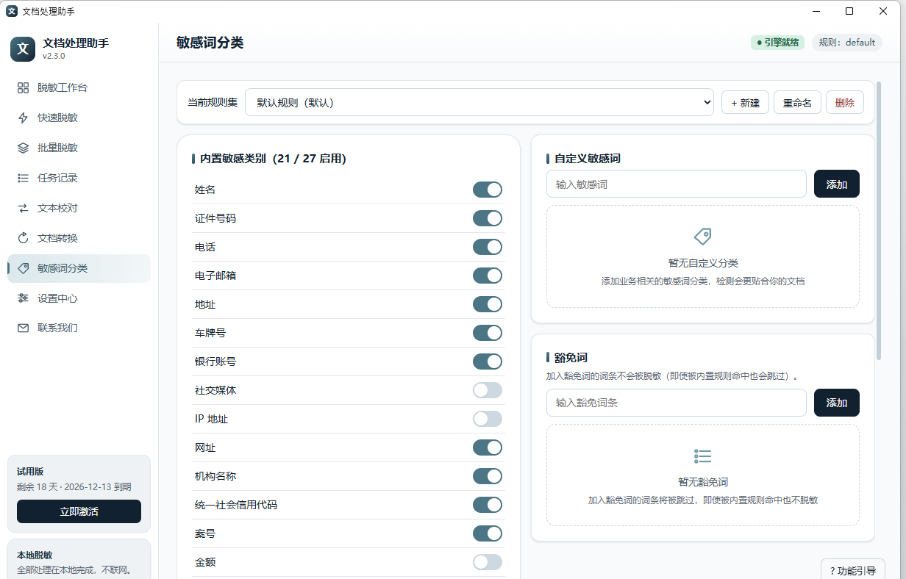
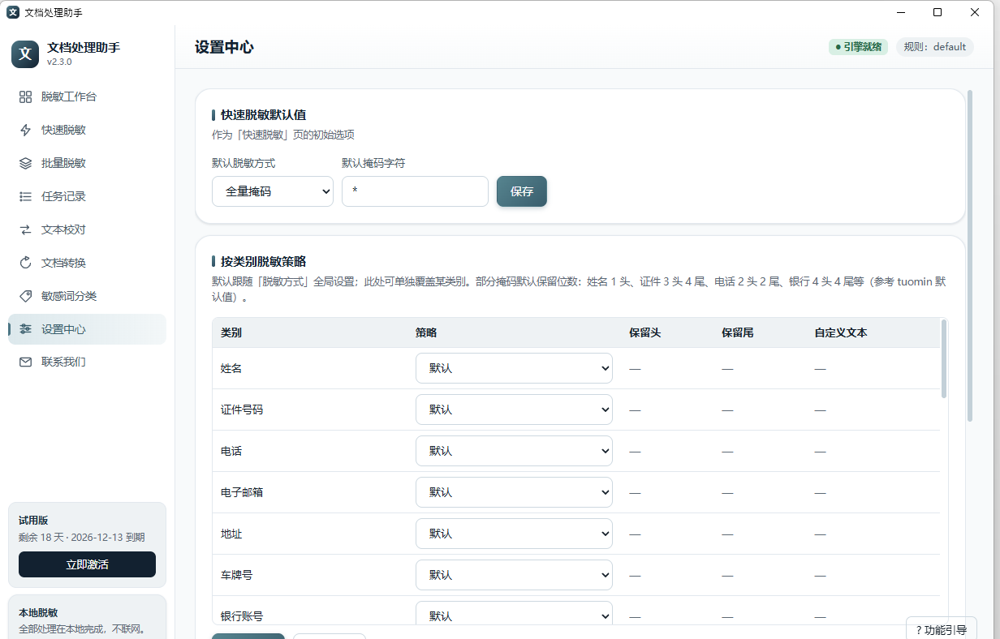
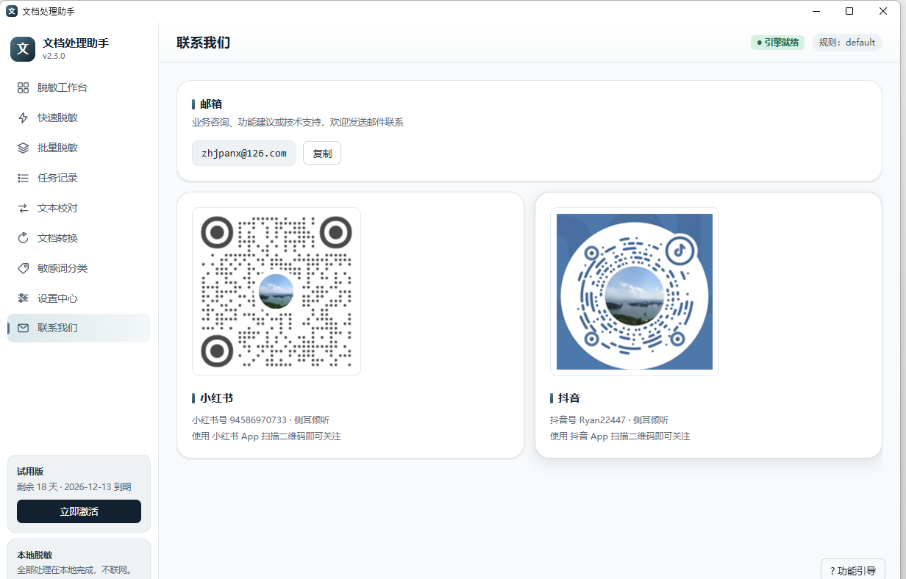

<div align="center">

# 文档处理助手

**面向法律与办公场景的敏感信息脱敏工具 · 本地离线处理，文件不出本机**

[](#下载)
[](https://github.com/zhengj20/DataShield/releases/latest)
[](#系统要求)

</div>

---

文档处理助手是一款**完全在本机运行**的文档脱敏工具，内置自研敏感信息检测引擎，
可对 Word / PDF / Excel / PPT 等文档中的姓名、证件号、电话、地址、案号等敏感字段
进行识别与打码替换。全过程**不联网、不上传**，适合律师、法务、合规等对数据出域敏感的场景。

## 功能特性

- **自研检测引擎**：内置脱敏引擎，识别常见个人敏感信息与法律文书专有字段
- **多格式支持**：Word (.docx) / PDF / Excel (.xlsx) / PPT (.pptx)
- **扫描件 OCR**：对扫描版 PDF 支持 OCR 识别后再脱敏
- **批量处理**：支持批量导入、统一规则处理
- **对比与替换**：脱敏前后可对比，支持自定义替换策略
- **纯本地运行**：所有处理在本地完成，不上传任何文件内容

## 界面预览

| 脱敏工作台 | 快速脱敏 |
| :---: | :---: |
|  |  |
| **批量脱敏** | **任务记录** |
|  |  |
| **文本校对** | **文档转换** |
|  |  |
| **敏感词分类** | **设置中心** |
|  |  |

## 下载

点击右侧 **Releases** 下载最新试用版压缩包：

> https://github.com/zhengj20/DataShield/releases/latest

下载后请核对文件完整性（可选）：

```powershell
# 将下载包与 Release 提供的 .sha256.txt 对比
Get-FileHash .\文档处理助手-试用版-v2.3.0.zip -Algorithm SHA256
```

## 安装与启动

本工具为**绿色免安装**版本：

1. 将压缩包**完整解压**到任意目录（请勿在压缩包内直接双击运行）；
2. 双击目录中的「文档处理助手」快捷方式，或 `launcher\启动处理助手.bat`；
3. 首次启动会初始化本机试用锚点，开始 30 天试用期。

## 试用与激活

- 自首次使用起提供 **30 天完整功能试用**（重装不会重置试用期）；
- 试用到期后需使用**激活码**解锁正式版；
- 如需购买或申请试用延期，请通过下方联系方式获取激活码。

## 系统要求

| 项目 | 要求 |
| --- | --- |
| 操作系统 | Windows 10 / 11（64 位） |
| 磁盘空间 | 约 2 GB（含本地 OCR 与解析组件） |
| 网络 | 运行期**无需联网** |

## 常见问题

- **杀毒软件提示**：本工具为未签名的绿色便携版，部分杀软可能误报。请从本页面 Releases 下载并校验 SHA256 后放行；切勿从其他来源下载。
- **双击无反应**：多为「未完整解压就在压缩包内运行」。请先完整解压再启动。
- **首次启动较慢**：首次运行会初始化本地解析/OCR 运行时，属正常现象。

## 隐私说明

文档处理助手为离线桌面应用，文档的读取、识别与脱敏全部在你的电脑本地完成，
不会将任何文档内容上传至第三方服务器。

## 许可与版权

本软件为闭源商业软件，保留所有权利。仅授予用户在试用/已激活设备上的使用许可，
不得反编译、二次分发或用于规避试用限制。

## 联系方式

- 激活码 / 商务咨询：<zhjpanx@126.com>
- 问题反馈：本仓库 [Issues](https://github.com/zhengj20/DataShield/issues)
